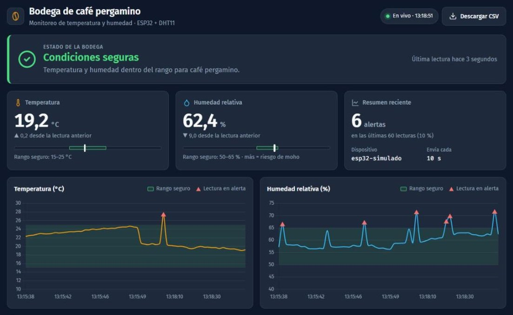
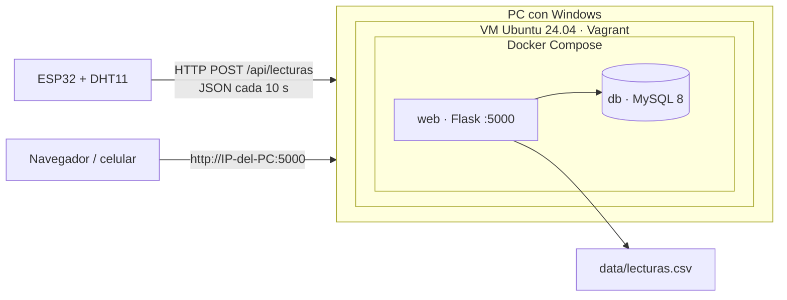
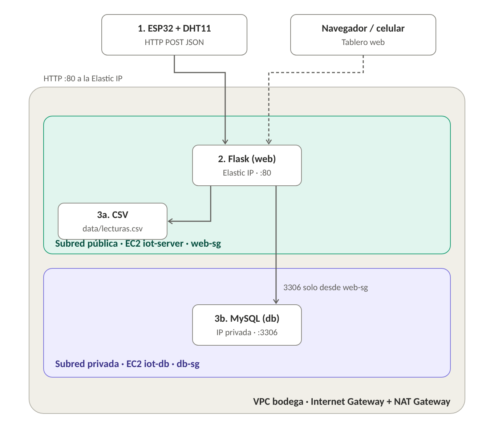
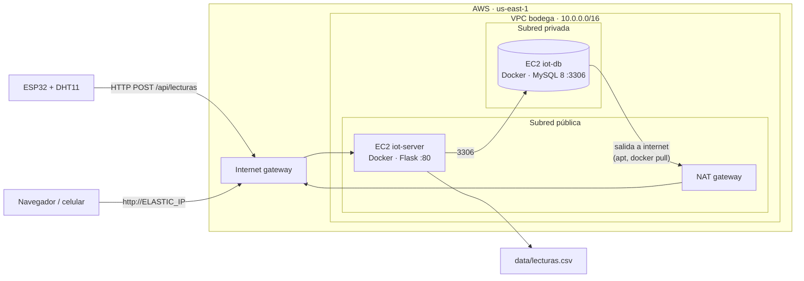

# ☕ Bodega de café pergamino — Monitoreo IoT

Un **ESP32 con sensor DHT11** mide la temperatura y la humedad de una bodega de café pergamino
y las envía cada 10 segundos por **HTTP POST (JSON)** a un servidor **Flask**. El servidor
clasifica cada lectura como **OK** o **ALERTA**, la guarda en **MySQL** y en un archivo **CSV**,
y la muestra en un **tablero web** que se actualiza solo.

Todo el servidor corre en **contenedores Docker** dentro de una **máquina virtual Ubuntu** creada con **Vagrant**.



---

## El caso de uso

Una cooperativa cafetera guarda **café pergamino seco** antes de venderlo. Si la humedad del
ambiente sube, el grano la absorbe, aparece **moho** y el café pierde puntaje de taza y precio.
Si baja demasiado, el grano se reseca y pierde peso. El registro histórico también sirve como
evidencia de buenas condiciones de almacenamiento ante compradores y certificadoras.

| Variable | OK (rango seguro) | ALERTA |
|---|---|---|
| Temperatura | 15 – 25 °C | fuera de ese rango |
| Humedad relativa | 50 – 65 % | > 65 % (riesgo de moho) o < 50 % (el grano se reseca) |

Una lectura es **ALERTA** si *cualquiera* de las dos variables sale de su rango.
La regla está en `calcular_estado()` de [server/app.py](server/app.py).

## Arquitectura



- **Vagrant** crea la VM e instala Docker solo. Reenvía el puerto **5000** de Windows a la VM,
  así el ESP32 y el celular llegan al servidor con la IP del PC.
- **web** (Flask): recibe las lecturas, las guarda y sirve el tablero. Es el único contenedor con puerto publicado.
- **db** (MySQL 8): **no publica puertos**; solo el contenedor `web` llega a ella por la red interna de Docker.
  La tabla se crea sola la primera vez con [db/init.sql](db/init.sql).
- **CSV**: la carpeta `data/` del proyecto está montada dentro del contenedor, así que
  `data/lecturas.csv` se ve directamente en Windows (y se abre en Excel).

## Estructura del repo

```
Vagrantfile               VM Ubuntu 24.04 con Docker (puerto 5000 reenviado)
docker-compose.yml        Contenedores web (Flask) y db (MySQL)
.env.example              Plantilla de claves de la BD (copiar como .env)
server/
  app.py                    Rutas: recibir lecturas, API JSON, CSV, health, tablero
  templates/index.html      Tablero web
  static/tablero.css        Estilos (modo oscuro y claro)
  static/tablero.js         Pide datos cada 5 s y dibuja tarjetas, gráficas y tabla
  Dockerfile, requirements.txt
db/init.sql               Tabla "lecturas"
esp32/esp32_bodega/       Código del ESP32 (+ secrets.example.h)
simulador/                Script que imita al ESP32 (probar sin hardware)
data/                     Aquí se genera lecturas.csv (no se sube a git)
docs/                     Imágenes del README
```

## Puesta en marcha

**Requisitos:** [VirtualBox](https://www.virtualbox.org/) y [Vagrant](https://developer.hashicorp.com/vagrant/install)
(o, si ya tienes Docker, ver *Sin Vagrant* más abajo).

1. Clonar el repo y crear el archivo de claves:

   ```bash
   git clone https://github.com/jorgegonzalezgom-create/bodega-cafe-iot.git
   cd bodega-cafe-iot
   cp .env.example .env        # en PowerShell: Copy-Item .env.example .env
   ```

   Editar `.env` y cambiar `DB_ROOT_PASS` y `DB_PASS` (las que dicen `cambiar`).

2. Crear la VM y levantar los contenedores (la primera vez tarda varios minutos):

   ```bash
   vagrant up
   vagrant ssh
   cd /vagrant
   docker compose up -d --build
   ```

3. Abrir **http://localhost:5000** → tablero. Desde el celular (misma Wi-Fi): `http://<IP-del-PC>:5000`.

**Sin Vagrant:** con Docker Desktop basta con el paso 1 y `docker compose up -d --build` en la carpeta del repo.

### Probar sin el ESP32 (simulador)

Desde Windows (fuera de la VM), con Python 3 instalado y sin librerías extra:

```bash
python simulador/simular_esp32.py --cantidad 30 --intervalo 1 --picos
```

Envía el mismo JSON que el ESP32. `--picos` sube de vez en cuando la humedad por encima del 65 %
para ver alertas. Sin `--cantidad` envía sin parar cada 10 s, como el ESP32 real. Para otro
servidor: `--url http://<IP>:5000`.

### Conectar el ESP32

**Materiales:** ESP32 DevKit, sensor DHT11 (módulo azul de 3 pines), cables dupont, cable USB de datos.

| DHT11 | ESP32 |
|---|---|
| VCC (+) | 3V3 |
| DATA (out) | GPIO 4 (D4) |
| GND (−) | GND |

El módulo de 3 pines ya trae la resistencia *pull-up*; si usas el sensor suelto de 4 pines,
pon una de 10 kΩ entre DATA y 3V3.

1. **Arduino IDE 2.x** → *Preferencias → URLs adicionales*:
   `https://espressif.github.io/arduino-esp32/package_esp32_index.json`, luego en el
   *Gestor de placas* instalar **esp32 (Espressif)** y elegir **ESP32 Dev Module**.
2. *Gestor de librerías*: **DHT sensor library** (Adafruit), que pide también **Adafruit Unified Sensor**.
3. Averiguar la IP del PC en la Wi-Fi (`ipconfig` en Windows).
4. En `esp32/esp32_bodega/` copiar `secrets.example.h` como `secrets.h` y poner la Wi-Fi
   (**2,4 GHz**: el ESP32 no ve redes de 5 GHz) y `SERVER_URL = "http://<IP-del-PC>:5000/api/lecturas"`.
5. Subir el sketch y abrir el **Monitor serie a 115200**. Debe mostrar:

   ```
   Enviado {"dispositivo":"esp32-01","temperatura":22.0,"humedad":58.0} -> HTTP 201
   ```

## El tablero

- **Estado de la bodega**: OK o ALERTA con icono y texto (no solo color), y el motivo en
  palabras, p. ej. *"Humedad alta: riesgo de moho (67,4 %, máx. 65 %)"*.
- **Temperatura y humedad** actuales, cambio respecto a la lectura anterior y un medidor con el rango seguro marcado.
- **Resumen**: cuántas alertas hubo en las últimas 60 lecturas.
- **Gráficas** de los últimos ~10 minutos con la **franja del rango seguro** sombreada;
  las lecturas en alerta se marcan con triángulos.
- **Tabla** de las últimas 20 lecturas, resaltando el valor que causó la alerta.
- **Conexión**: indica *En vivo*, *Sin datos del ESP32 hace X* (si pasan más de 30 s sin
  lecturas) o *Sin conexión con el servidor*.
- Botón **Descargar CSV**. Se adapta a celular y respeta el modo claro/oscuro del sistema.

Las gráficas y la tipografía se cargan de internet (Chart.js y Google Fonts). Sin internet
el tablero sigue funcionando, pero sin gráficas.

## API

| Método | Ruta | Qué hace |
|---|---|---|
| POST | `/api/lecturas` | Guarda una lectura. Cuerpo: `{"dispositivo": "esp32-01", "temperatura": 22.5, "humedad": 58.0}` → `201 {"ok": true, "estado": "OK"}` |
| GET | `/api/lecturas?limite=50` | Últimas lecturas en JSON, la más reciente primero (máx. 500) |
| GET | `/api/lecturas.csv` | Descarga el CSV completo |
| GET | `/health` | `{"status": "ok", "db": true}` si la app llega a MySQL |
| GET | `/` | Tablero web |

- La **fecha la pone el servidor** (hora de Colombia, `America/Bogota`), así el ESP32 no necesita reloj.
- Si el JSON está mal (falta un campo, no es número, `NaN`, valores imposibles para el sensor
  o un nombre de dispositivo de más de 30 caracteres) responde **400** con el motivo y **no guarda nada**,
  ni en MySQL ni en el CSV.

## Verificar que los datos se guardan

Criterio de evaluación: *los datos deben verificarse en el CSV y en la base de datos*.
Dentro de la VM (`vagrant ssh` → `cd /vagrant`):

```bash
# Base de datos: últimas 10 lecturas
docker compose exec db sh -c 'mysql -u"$MYSQL_USER" -p"$MYSQL_PASSWORD" "$MYSQL_DATABASE" -e "SELECT * FROM lecturas ORDER BY id DESC LIMIT 10;"'

# Base de datos: cuántas OK y cuántas ALERTA
docker compose exec db sh -c 'mysql -u"$MYSQL_USER" -p"$MYSQL_PASSWORD" "$MYSQL_DATABASE" -e "SELECT estado, COUNT(*) FROM lecturas GROUP BY estado;"'

# CSV (también se puede abrir data/lecturas.csv en Excel desde Windows)
tail data/lecturas.csv
```

El número de filas del CSV (sin el encabezado) debe coincidir con el de la tabla `lecturas`.

## Comandos útiles

```bash
docker compose logs -f web        # ver en vivo las lecturas que llegan
docker compose ps                 # estado de los contenedores
docker compose up -d --build      # reconstruir después de cambiar código
docker compose down               # parar (los datos se conservan)
docker compose down -v            # parar y BORRAR la base de datos
```

Para apagar la VM: `exit` para salir de ella y, ya en Windows, `vagrant halt`.

## Problemas frecuentes

| Síntoma | Solución |
|---|---|
| `vagrant up` se queda en *Timed out while waiting for the machine to boot* | Activar la virtualización (VT-x/AMD-V) en la BIOS. Si Hyper-V/WSL2 está activo, VirtualBox va más lento: el `Vagrantfile` ya da 10 min de espera. |
| Variables vacías o error de acceso a MySQL al hacer `up` | Falta el archivo `.env` (copiar `.env.example`). Si cambiaste las claves después del primer arranque, MySQL sigue con las viejas: `docker compose down -v` y volver a levantar (borra los datos). |
| El tablero carga en el PC pero no en el celular / el ESP32 da `-1` | Misma Wi-Fi de 2,4 GHz, IP correcta del PC y abrir el puerto en el firewall de Windows (ver abajo). Algunas redes de universidad aíslan los equipos: usar el hotspot del celular. |
| El ESP32 da `400` | El servidor rechazó el JSON. La respuesta trae el motivo en `error`; para verlo, enviar la misma lectura con el simulador o con `curl`. |
| `Error sensor` en el Monitor serie | Revisar cableado (VCC a 3V3, DATA a GPIO 4, GND) y que `DHTTYPE` sea `DHT11`. |
| El puerto 5000 ya está ocupado en Windows | Cambiar `host: 5000` en el `Vagrantfile` (y la URL del ESP32). |

Abrir el puerto 5000 en el firewall de Windows (PowerShell **como administrador**):

```powershell
New-NetFirewallRule -DisplayName "Bodega cafe 5000" -Direction Inbound -Protocol TCP -LocalPort 5000 -Action Allow -Profile Any
```

## Limitaciones conocidas

- El **DHT11** tiene una precisión de ±2 °C y ±5 % HR. Cerca del límite de 65 % una lectura
  puede marcar ALERTA por error del sensor; un DHT22 (±0,5 °C, ±2 % HR) es más fiable y el
  código solo cambia en `DHTTYPE`.
- El endpoint `POST /api/lecturas` no pide autenticación: cualquiera en la misma red podría
  enviar lecturas. Para un despliegue real habría que añadir una clave (`X-API-Key`) y HTTPS.
- Flask corre con su servidor de desarrollo, suficiente para uno o pocos ESP32.

# Despliegue en la nube (AWS)
Nota: La implementación y la configuración del despliegue vía HTTP (local con Vagrant y Docker, y en AWS con VPC, subred pública y privada) se documentaron en el siguiente repositorio: https://github.com/1alejandraguadir/bodega-cafe-iot

En producción el sistema corre en **AWS** dentro de una **VPC** con dos subredes: el servidor
web queda en la **subred pública** (accesible por HTTP desde internet) y la base de datos en la
**subred privada** (sin IP pública, solo el servidor web llega a ella).





### Componentes

| Componente | Dónde | Para qué |
|---|---|---|
| **VPC** `bodega-vpc` | `10.0.0.0/16`, 1 zona de disponibilidad | Red aislada del proyecto |
| **Internet gateway** | VPC | Entrada y salida a internet de la subred pública |
| **NAT gateway** | Subred pública | Deja que la base de datos descargue paquetes e imágenes sin tener IP pública |
| **EC2 `iot-server`** | Subred pública, con **Elastic IP** | Contenedor `web` (Flask): recibe lecturas, guarda el CSV y sirve el tablero en el puerto **80** |
| **EC2 `iot-db`** | Subred privada, **sin IP pública** | Contenedor `db` (MySQL 8) |

Las dos EC2 son Ubuntu Server 24.04 (`t3.micro`) con Docker y Docker Compose.

### Security Groups

| Grupo | Entrada permitida | Origen |
|---|---|---|
| `web-sg` (servidor) | HTTP 80 | `0.0.0.0/0` (ESP32 y navegadores) |
| | SSH 22 | IP del administrador |
| `db-sg` (base de datos) | MySQL 3306 | Solo `web-sg` |
| | SSH 22 | Solo `web-sg` (se entra saltando desde el servidor) |

La salida de ambos grupos queda abierta (por defecto) para poder instalar paquetes.

### Archivos de Docker Compose para AWS

En local los dos contenedores corren juntos con `docker-compose.yml`. En AWS se separan en dos
archivos, uno por máquina:

- **`docker-compose.db.yml`** → se ejecuta en `iot-db`. Levanta MySQL y crea la tabla con `db/init.sql`.
- **`docker-compose.web.yml`** → se ejecuta en `iot-server`. Levanta Flask publicado en el puerto **80**
  y se conecta a MySQL usando `DB_HOST` (IP privada de `iot-db`).

No hace falta cambiar código: `server/app.py` ya lee la conexión de las variables
`DB_HOST`, `DB_USER`, `DB_PASS` y `DB_NAME`.

### Puesta en marcha en AWS

**1. Red (consola de AWS)**

- *VPC → Crear VPC → VPC y más*: nombre `bodega`, 1 AZ, 1 subred pública, 1 subred privada,
  NAT gateway **Zonal (1 AZ)**, sin endpoints.
- *EC2 → Security Groups*: crear `web-sg` y `db-sg` con las reglas de la tabla anterior.
  AWS no permite nombres que empiecen por `sg-`.

**2. Máquinas**

- `iot-server`: Ubuntu 24.04, subred **pública**, IP pública habilitada, grupo `web-sg`.
  Asociarle una **Elastic IP** para que la dirección no cambie.
- `iot-db`: Ubuntu 24.04, subred **privada**, IP pública deshabilitada, grupo `db-sg`.
- Ambas con el mismo par de claves (`.pem`).

**3. Entrar por SSH**

```bash
# Desde el PC al servidor
ssh -i bodega-key.pem ubuntu@<ELASTIC_IP>

# Desde el servidor a la base de datos (no tiene IP pública)
ssh -i bodega-key.pem ubuntu@<IP_PRIVADA_DB>
```

> En Windows, si SSH responde *UNPROTECTED PRIVATE KEY FILE*, dejar la llave solo para tu usuario:
> `icacls bodega-key.pem /inheritance:r` y `icacls bodega-key.pem /remove *S-1-5-11 *S-1-5-32-545 *S-1-1-0`.

**4. Instalar Docker (en las dos EC2)**

```bash
sudo apt update && sudo apt install -y docker.io docker-compose-v2 git
sudo usermod -aG docker ubuntu
exit    # volver a entrar para que aplique el permiso
```

**5. Base de datos (en `iot-db`)**

```bash
git clone https://github.com/1alejandraguadir/bodega-cafe-iot.git
cd bodega-cafe-iot
cp .env.example .env && nano .env      # poner las claves
docker compose -f docker-compose.db.yml up -d
```

**6. Servidor web (en `iot-server`)**

```bash
git clone https://github.com/1alejandraguadir/bodega-cafe-iot.git
cd bodega-cafe-iot
cp .env.example .env && nano .env      # mismas claves + DB_HOST=<IP_PRIVADA_DB>
mkdir -p data
docker compose -f docker-compose.web.yml up -d --build
curl http://localhost/health           # {"db":true,"status":"ok"}
```

### Conectar el ESP32 y el simulador a AWS

En `esp32/esp32_bodega/secrets.h`:

```cpp
#define SERVER_URL "http://<ELASTIC_IP>/api/lecturas"
```

A diferencia del modo local, el ESP32 ya no necesita estar en la misma red del PC: basta
cualquier Wi-Fi de **2,4 GHz** con internet.

Simulador desde el PC:

```bash
python simulador/simular_esp32.py --url http://<ELASTIC_IP> --cantidad 10 --intervalo 1 --picos
```

### Verificar en AWS

```bash
# Tablero
http://<ELASTIC_IP>

# Lecturas llegando en vivo (en iot-server)
docker compose -f docker-compose.web.yml logs -f web

# CSV (en iot-server)
tail data/lecturas.csv

# MySQL (en iot-db)
docker compose -f docker-compose.db.yml exec db sh -c 'mysql -u"$MYSQL_USER" -p"$MYSQL_PASSWORD" "$MYSQL_DATABASE" -e "SELECT * FROM lecturas ORDER BY id DESC LIMIT 10;"'
```

En la consola, *VPC → bodega-vpc → Mapa de recursos* muestra las subredes, tablas de rutas,
internet gateway y NAT.

### Problemas frecuentes en AWS

| Síntoma | Solución |
|---|---|
| El navegador se queda cargando con `http://<ELASTIC_IP>` | Falta la regla **HTTP 80** en `web-sg`, o la instancia no tiene asignado `web-sg`. |
| `/health` responde `"db": false` | Revisar `DB_HOST` y que las claves del `.env` sean iguales en las dos EC2. MySQL tarda unos segundos la primera vez. |
| `apt update` no avanza en `iot-db` | El NAT gateway no está creado o la subred privada no tiene ruta hacia él. |
| `curl` responde *Connection reset* justo después de levantar | Flask todavía está arrancando; esperar unos segundos. |


